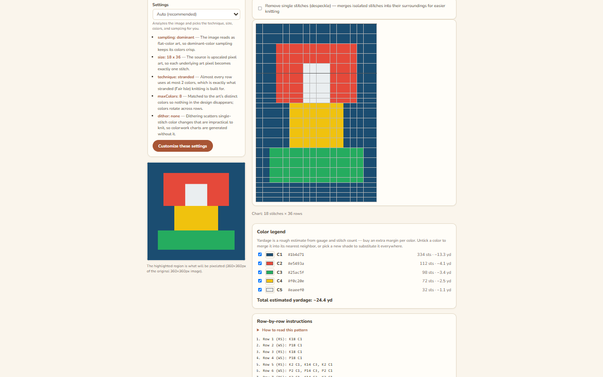

# Knitting Pattern Maker

[](https://github.com/John-Donnelly/KnittingPatternMaker/actions/workflows/ci.yml)


<p align="center">

</p>

Turn an image into deterministic pixel art and a knitting pattern containing a
chart, row-by-row instructions, colour legend, yardage estimate and PDF/PNG
exports. The core algorithms are shared between browser/server deployment paths
so pattern-generation behaviour is not maintained as two separate
implementations.

**Every pattern setting is optional.** Auto mode analyses the image and chooses
technique, chart size, colour count, sampling and dithering when those values are
not supplied. Manual controls can override any subset.


Current core pattern modes include stranded colourwork, intarsia and single-
colour knit/purl texture. See [docs/KNITTING_NOTES.md](docs/KNITTING_NOTES.md)
for the knitting conventions and assumptions encoded by the generators, and
[docs/ARCHITECTURE.md](docs/ARCHITECTURE.md) for request/data-flow details and
known limits.

## Monorepo layout

```text
packages/core   deterministic image/pattern algorithms and shared types
apps/api        Fastify/Node API, auth, SQLite saved patterns and PDF/PNG export
apps/web        React + Vite browser UI
apps/worker     Cloudflare Worker/Hono deployment with D1 and Worker export paths
docs            architecture and knitting-domain notes
```

## Requirements

- Node.js >= 22 (see `.nvmrc`; the root `package.json` declares `>=22.0.0`)
- npm >= 10 (npm workspaces)

## Getting started

```bash
npm install
npm run build
npm test
npm run dev:api
npm run dev:web
```

The default local API is `http://localhost:4000`; the Vite frontend normally
runs at `http://localhost:5173` and proxies `/api` during development.

Open the frontend and drop in an image. Auto mode chooses unset options and the
preview re-runs as controls change. Dominant-colour sampling is useful for
existing flat/pixel-art charts where averaged colours would be undesirable.

A share link encodes the pattern specification needed to reconstruct the pattern
rather than requiring the original uploaded image. Review the size/validation
limits in the architecture document before treating arbitrary links as an
unbounded persistence mechanism.

## Root scripts

| Script | Purpose |
|---|---|
| `npm run build` | Build workspaces in dependency order |
| `npm test` | Run workspace test suites |
| `npm run lint` | ESLint across the repository |
| `npm run format` | Prettier write |
| `npm run typecheck` | TypeScript type checking |
| `npm run dev:api` | Fastify development server |
| `npm run dev:web` | Vite development server |

## API

The Node API currently exposes the pattern/export routes plus auth/saved-pattern
routes implemented under `apps/api/src/routes/`.

Core generation/export entry points include:

| Endpoint | Purpose |
|---|---|
| `POST /api/pattern` | multipart image + optional pattern options; returns computed pattern/auto decisions |
| `POST /api/export/pdf` | export a supplied pattern/grid as PDF |
| `POST /api/export/png` | export the chart as PNG |

When OIDC is configured, the auth surface includes login, callback, logout and
current-user routes. Saved-pattern routes are session-gated and store each
pattern's self-contained share specification rather than the original uploaded
image.

See [docs/ARCHITECTURE.md](docs/ARCHITECTURE.md) for full shapes and pipeline
behaviour.

## Deployment

There are two maintained deployment implementations:

- **Cloudflare Worker** — Hono Worker serving API + built SPA with D1 persistence
  and Worker-native image/export support. Follow
  [apps/worker/README.md](apps/worker/README.md) and
  `apps/worker/wrangler.jsonc` for the current configuration/deploy contract.
- **Node/Docker** — Fastify API plus built frontend, SQLite persistence and the
  Node PDF/PNG export path.

### Node/Docker configuration

The tracked `.env.example` is the canonical starting point for the Node/Docker
configuration consumed by `apps/api/src/config.ts`. Copy it to `.env`, then set
production-appropriate values rather than committing secrets:

```bash
cp .env.example .env
```

Key values include:

```text
NODE_ENV=production
PUBLIC_URL=https://your-host.example
SESSION_SECRET=<at least 32 characters>
HOST=0.0.0.0
PORT=4000
# For a local Node process, keep the database under the repository:
DATA_DIR=./data
```

The data directory differs by execution path. `DATA_DIR=./data` is a local
Node-process path relative to the repository. For Docker, set
`DATA_DIR=/data`: the tracked image creates `/data`, gives it to the `node` user
and declares it as a volume, so it is the image-prepared writable location.
Because `docker-compose.yml` passes `.env` into the container, leaving the
copied example's `./data` value in place overrides that image default and points
at `/app/data` instead.

Optional OIDC configuration:

```text
OIDC_ISSUER=https://issuer.example
OIDC_CLIENT_ID=...
OIDC_CLIENT_SECRET=...
# OIDC_REDIRECT_URI defaults to ${PUBLIC_URL}/api/auth/callback
AUTH_REQUIRED=true
```

Other current Node settings include `LOG_LEVEL`, `RATE_LIMIT_MAX` and
`STATIC_ROOT`.

There is an important current parser trap: do not copy an active
`AUTH_REQUIRED=false` into `.env` when auth should be disabled. The config uses
`z.coerce.boolean()`, so the non-empty string `"false"` is coerced to `true`.
The no-code workaround is to omit or comment out `AUTH_REQUIRED`, which leaves
the schema default at false. If `AUTH_REQUIRED=true` is set, provide all three
OIDC values — `OIDC_ISSUER`, `OIDC_CLIENT_ID` and `OIDC_CLIENT_SECRET` — or
production configuration is rejected.

`SESSION_SECRET` is mandatory in production. `PUBLIC_URL` must also be changed
from the localhost default in production; the config loader fails fast if these
requirements are not met. `AUTH_REQUIRED=true` is rejected unless the complete
OIDC issuer/client-id/client-secret set is configured.

The current tracked `Dockerfile` still uses Node 20 for both its build and
runtime stages, despite the Node >=22 requirement above. Until that source
mismatch is reconciled, `docker compose up --build` is not a source-backed,
validated production recipe for the current project.

After creating and reviewing `.env`, build/start through Docker:

```bash
docker compose up --build
```

Use TLS in front of production deployments. The current Node server applies
secure headers, rate limiting and upload/input limits; Cloudflare deployments
have their own Worker/WAF controls documented in the Worker README.

### Accounts and saved patterns

With OIDC enabled, signed-in users can save/list/open/delete patterns. The Node
path uses SQLite under `DATA_DIR`; the Worker path uses its D1 binding. Pattern
records persist the share specification, not the source upload.

Review [PRIVACY.md](PRIVACY.md) before a public deployment because operational
placeholders such as contact/region/jurisdiction still require deployment-specific
values.

### Payments status

Stripe/payment processing is **not implemented in the current tracked source**.
The account data model contains plan/customer seams that can support a future
billing integration, but the repository currently has no billing checkout or
webhook route and the tracked environment/config surface does not define a
working Stripe integration.

If billing is added later, treat checkout, webhook verification, entitlement
updates, secrets and refund/subscription behaviour as a separate implementation
and security surface; do not infer that it exists from the current `plan` fields.

## Licence and privacy

Licensing metadata is currently inconsistent: the tracked [LICENSE](LICENSE)
file contains the **MIT License** (Copyright © 2026 John Donnelly), while the
root `package.json` declares `"license": "UNLICENSED"`. Resolve this repository
metadata conflict before relying on the badge or treating the project as
published under MIT.

[PRIVACY.md](PRIVACY.md) describes the service-data model. Uploaded images are
intended to be processed for pattern generation rather than retained as account
assets; saved patterns/account information exist only on the configured
server-side account path. Verify the privacy document and deployment-specific
third parties/region/contact details before publishing a hosted service.
